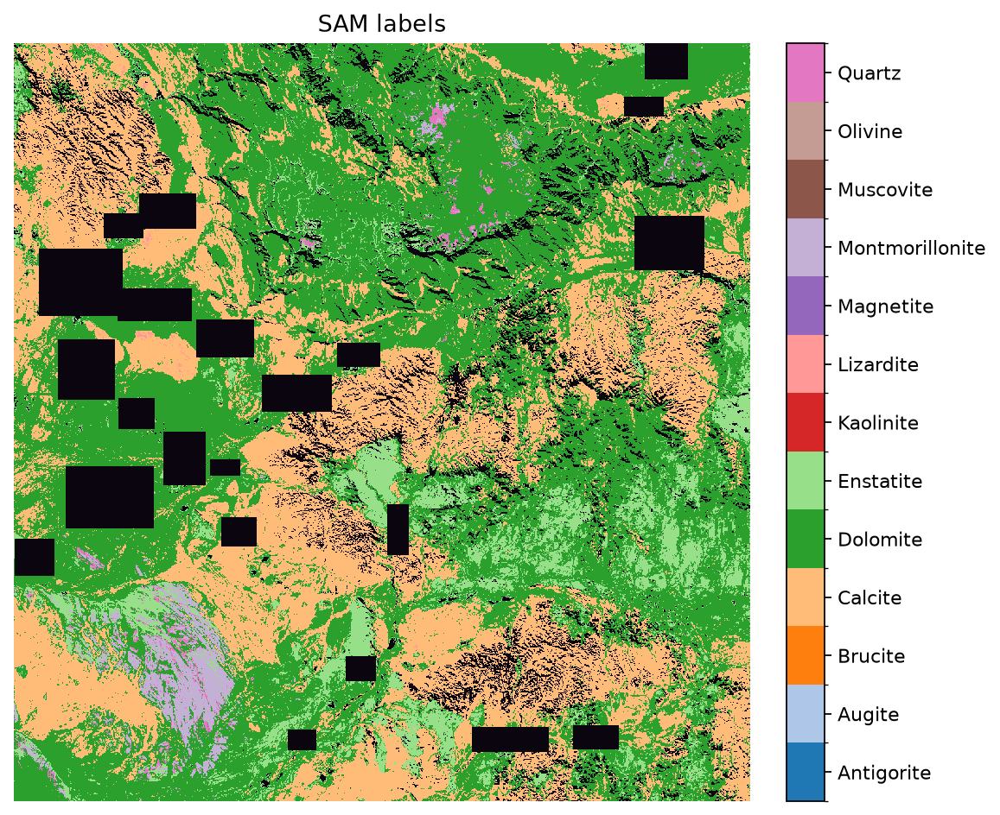
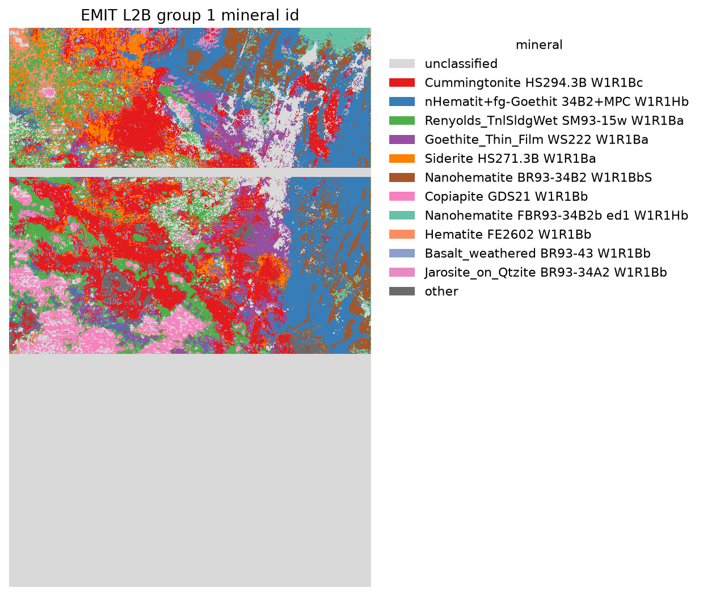
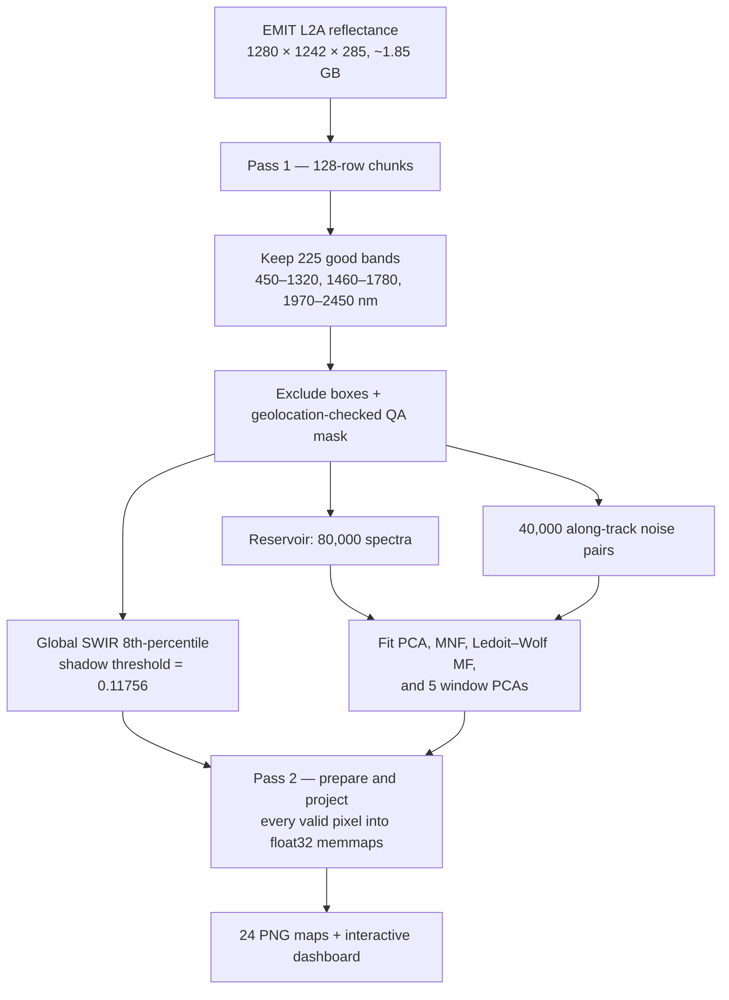

# Serpentine Signals

### Streaming Hyperspectral Mapping of Carbon-Storage Minerals in the Samail Ophiolite with NASA EMIT

A memory-safe streaming pipeline that maps serpentine, carbonate and other carbon-storage minerals across Oman's Samail ophiolite, using PCA, MNF, matched-filter and SAM analysis of NASA EMIT hyperspectral imagery, with an interactive dashboard for exploring the results.

**Live demo:** [kevinhaoaus.github.io/EMITOphiolite](https://kevinhaoaus.github.io/EMITOphiolite/)
**Slides (PDF):** [presentation/EMIT_Oman_Ophiolite_Defense.pdf](https://github.com/kevinhaoaus/EMITOphiolite/blob/main/presentation/EMIT_Oman_Ophiolite_Defense.pdf)
([PowerPoint](presentation/EMIT_Oman_Ophiolite_Defense.pptx))
**Session export:** [session/](session/)
**Track:** Berkeley × Stanford Grok Bot Hackathon — Track 03, Most Technically Complex


*MNF RGB composite of NASA EMIT L2A granule `EMIT_L2A_RFL_001_20260220T072251_2605105_013`, acquired 20 February 2026. Independent 2–98% stretches on the first three components.*

<p align="center">
  
  
  
</p>

*Left to right: PCA RGB composite of the same granule; spectral-angle mapper (SAM) labels from 13 USGS library targets; official EMIT L2B mineral product for a different date and scene (`EMIT_L2B_MIN_001_20260326T084318_2608506_030`, 26 March 2026), shown as a complementary cross-check, not a pixel-wise validation.*

## Inspiration

The Samail ophiolite in Oman exposes mantle peridotite at the surface — one of the largest and best-studied such massifs on Earth. That rock can lock carbon dioxide into solid carbonate minerals. Kelemen & Matter (2008) estimated that converting all magnesium cations in the Oman peridotite to carbonate would consume about 77 trillion tons of CO₂, a theoretical upper bound on solid storage in this massif. The same paper argued that engineered in situ carbonation *could* consume more than 1 billion tons of CO₂ per year in Oman alone, up to 10⁶ times faster than the natural weathering flux of 10⁴–10⁵ tons per year. Later work put the cost of solid storage at high temperature and CO₂ pressure on the order of ~$10/t (Kelemen et al. 2019, citing NASEM 2019, Fig. 6.17). Those rate and dollar figures are illustrative upper bounds, not measured operations: they assume drilling, hydraulic fracture, purified CO₂, and sustained high temperature at depth.

To take any of that seriously on the ground, operators and geologists need maps of where serpentine, carbonate, and related alteration minerals already are. NASA's Earth Surface Mineral Dust Source Investigation (EMIT), launched 14 July 2022 and flying on the International Space Station, measures 285 wavelengths from 381–2493 nm at a nominal 60 m ground sample distance (Thorpe et al. 2023; Carmon et al. 2022). Official L2B mineral maps exist, but a full custom analysis — noise-adjusted components, library matched filters, diagnostic-window PCA, and a transparent quality-control path — still has to confront a practical problem: a single L2A reflectance cube is about 1.85 GB, and a naive pipeline that holds several copies of it will run out of memory on a laptop.

This project started from that gap: turn one real EMIT scene over the Samail ophiolite into mineral maps that a carbon-storage or exploration team can inspect, without requiring a workstation-class RAM budget, and put the methods and the scores in front of a person rather than leaving them in a folder of arrays.

## What it does

The pipeline reads an EMIT L2A surface-reflectance cube and writes a consistent set of mineral-mapping products:

- A principal-component (PCA) RGB composite and per-component score maps.
- A real minimum-noise-fraction (MNF) RGB composite, using along-track difference noise and the Green et al. (1988) generalized eigenproblem — not a covariance PCA mislabeled as MNF.
- Ledoit–Wolf matched-filter score maps against 13 USGS Spectral Library Version 7 (splib07) target spectra (Kokaly et al. 2017).
- A spectral-angle mapper (SAM) classification with a 0.12 rad cutoff, plus the per-pixel best angle.
- Windowed PCA (at most 5 components) inside five diagnostic wavelength intervals used by this pipeline: hematite 550–950 nm, chlorite 2180–2265 nm, carbonate 2280–2380 nm, alteration 2100–2380 nm, and serpentine 2280–2340 nm.

It does this in two streaming passes over 128-row chunks, fitting models on a reservoir sample so the full 1280 × 1242 × 285 cube is never loaded at once. A separate quicklook renders the official EMIT L2B mineral identification product, joining class names on `mineral_metadata/index == id` rather than on array position.

A local FastAPI dashboard (vanilla JS and SVG, no CDN) lets you run tests or the pipeline from buttons, inspect a clickable pipeline diagram with the real run numbers, compare PCA components with matched-filter scores, pan and zoom the score maps, plot a pixel spectrum next to the USGS library, and browse the L2B mineral map. A read-only static export of that dashboard is what the [live demo](https://kevinhaoaus.github.io/EMITOphiolite/) serves — the Run button is local-only, because the raw granules are not in the repository.

## How we built it (tech stack)

**Core pipeline (Python 3.11):** NumPy; h5py / netCDF4 / h5netcdf / xarray for lazy cube I/O; SciPy (`eigh` for the MNF generalized eigenproblem, Savitzky–Golay smoothing); scikit-learn `LedoitWolf` shrinkage for the matched-filter background; Matplotlib for the 24 PNG maps; pytest (18 tests).

**Dashboard:** FastAPI + uvicorn, Pillow, and a vanilla JavaScript / inline-SVG front end bound to `127.0.0.1:8000`. No CDN, no build step.

**Static showcase:** a static export of the dashboard, hosted on GitHub Pages.

**Data:** NASA EMIT L2A reflectance and L2B mineral products (LP DAAC) and USGS splib07 library spectra. The 20 February 2026 L2A granule processed in the demo is a real observed scene, not a mock or synthetic cube. It is a single archived granule, not a live auto-updating feed.



1. **Pass 1 (cheap, raw reflectance).** Each chunk drops bad bands, applies the 22 manual exclude boxes and an optional quality mask, records SWIR brightness, and reservoir-samples up to 80,000 finite spectra for signal covariance plus up to 40,000 one-pixel along-track difference pairs for MNF noise, including pairs that straddle chunk boundaries.
2. A single **global** 8th-percentile SWIR shadow threshold is computed over the whole scene (0.11756 on this run) so every chunk shares the same cutoff.
3. Sampled non-shadow pixels are prepared — NDVI > 0.25 removed, Savitzky–Golay filter of window 11 and order 2, upper-hull continuum removal — and used to fit PCA, the matched-filter background, and the five window PCAs. MNF is solved as the generalized eigenproblem below.
4. **Pass 2.** Each chunk is prepared again with that same threshold, and every valid pixel is projected into `.npy` memmaps (PCA, MNF, 13 matched filters, SAM, window PCAs).
5. PNGs are rendered from the memmaps with independent 2–98% stretches on the RGB composites.

The detectors themselves are the standard ones, implemented here as follows.

**Minimum noise fraction** (Green et al. 1988) — leading generalized eigenvectors of the signal and noise covariances, eigenvalues descending:

$$
\Sigma_S \mathbf{v} = \lambda \Sigma_N \mathbf{v}
$$

**Ledoit–Wolf shrinkage** (Ledoit & Wolf 2004), used for the matched-filter background when the number of fit spectra exceeds the number of bands, via `sklearn.covariance.LedoitWolf`. If $N \le B$, the pipeline falls back to a sample covariance with a small eigenvalue ridge:

$$
\hat{\Sigma} = (1-\delta)S + \delta \mu I
$$

**Matched filter** (see Manolakis, Marden & Shaw 2003) with a shared shrunk background $(\mathbf{m},\hat{\Sigma})$, evaluated with a linear solve rather than an explicit inverse:

$$
\mathrm{MF}(\mathbf{x}) = \frac{(\mathbf{t}-\mathbf{m})^{\top}\hat{\Sigma}^{-1}(\mathbf{x}-\mathbf{m})}{(\mathbf{t}-\mathbf{m})^{\top}\hat{\Sigma}^{-1}(\mathbf{t}-\mathbf{m})}
$$

**Spectral angle mapper** (Kruse et al. 1993), in radians, with a 0.12 rad cutoff:

$$
\theta(\mathbf{x},\mathbf{t}) = \arccos\left(\frac{\mathbf{x}\cdot\mathbf{t}}{\|\mathbf{x}\|\,\|\mathbf{t}\|}\right)
$$

## Challenges we ran into

**Out-of-memory on a 1.85 GB cube.** The earlier design held the full reflectance cube, a working copy, and the prepared spectra in RAM — on the order of three full-cube copies — and could not finish the 013 scene. The rewrite streams 128-row chunks, fits on a reservoir of 80,000 spectra (and 40,000 noise pairs), and writes float32 memmaps. The full scene then ran in 654 s at a peak of 2,297 MB; a 256-row subset ran in 201 s at 1,959 MB.

**A quality mask that was the wrong scene.** The adjacent L2A MASK granule (`…_2605105_012`) has the same 1280 × 1242 shape as the 013 reflectance cube, but its lat/lon is offset by up to 0.5706°. Applying it would have flagged 119,667 pixels on the wrong footprint. The pipeline checks both shape and geolocation (agreement within 0.001°) and refuses the mask unless `--force-quality-mask` is set. That rejection is a robustness feature, not a skipped step.

**L2B legend names were wrong.** Mineral names in the L2B product live in `mineral_metadata/name` and must be joined where `mineral_metadata/index == id`. The index starts at 1, so joining by array position maps every class to the wrong name. The quicklook and the dashboard now join on `index == id`; id 0 is unlabeled as unclassified, and the fill value −9999 is not drawn.

**A continuum-removal bug.** `continuum_remove` was missing its wavelengths argument, so hull removal could not be applied correctly during preparation. That one-line fix is in the shared preprocessing path used by the pipeline and by the dashboard's pixel-spectrum plot.

**MNF noise direction.** A correct MNF is only as good as its noise estimate. The streaming fit uses one-pixel *along-track* (down-track) differences, including pairs that cross chunk boundaries, rather than treating a covariance PCA as “MNF.” Getting that direction, the pair count (40,000 of 1,462,041 available), and the generalized eigenproblem to agree took careful testing.

**UTF-16 logs on Windows.** Pipeline and test output captured through the Windows console sometimes arrived as UTF-16, which broke naive log parsers in the dashboard. The app now tolerates that encoding so run logs and live progress (`pass N chunk i/10`) stay readable.

**The Windows Python launcher.** The default `python` on the development machine was 3.14 and did not have the science stack. Every install, test, and run has to go through `py -3.11`.

## Accomplishments

- A full 1280 × 1242 × 285 scene (225 good bands, 1,342,469 prepared pixels) processed in 654 s at 2,297 MB peak, instead of exhausting RAM.
- 18/18 tests passing in 4.38 s, including four new streaming tests; the suite was not weakened to hide an OOM.
- 24 PNG map products: PCA and MNF RGBs, SAM labels and angles, best-of matched-filter labels, 13 per-mineral matched-filter maps, 5 window PCA RGBs, and the L2B quicklook.
- A geolocation-aware quality-mask check that correctly rejected a same-shape, wrong-scene MASK file.
- An interactive local dashboard (Run, Pipeline, Scores, Map explorer, L2B minerals, Runs) and a public read-only GitHub Pages demo.
- A 14-slide technical defense deck with sourced impact figures and the real run numbers, linked above.

## What we learned

Streaming I/O plus reservoir sampling is enough to fit global PCA, MNF, and a shrunk matched-filter background on a laptop, provided the shadow threshold is computed once for the whole scene and not as a per-chunk percentile. Shape agreement is not identity: a quality mask has to be checked for geolocation, or it will quietly punch holes in the wrong place. Categorical metadata in NASA products is not always indexed from zero; joining L2B names by array position is a silent, total failure. And a default SAM cutoff of 0.12 rad was too loose for this scene: the median best angle was 0.025 rad, and the cutoff rejected none of the 1,342,469 prepared pixels. That is a result, not a success metric — the threshold should be tightened.

## What's next

The current demo processes one archived granule from 20 February 2026. It is real EMIT L2A data, but it is not yet a live, automatically updating feed. The next engineering step is to pull the newest EMIT L2A granules over Oman from NASA Earthdata / LP DAAC via CMR search, so a rerun can follow the latest overpass rather than a hard-coded file path.

Beyond that: tighten the SAM cutoff (and report rejected-pixel fractions honestly); stack multiple dates instead of a single scene; compare maps with field or higher-resolution spectra where they exist; and scale the same streaming path from one 60 m scene to more of the ophiolite.

## How Grok Bot helped build it

Grok Bot (this assistant, “EPS 185”) acted as the coordinator, with its own computer as well as a shell on the development PC. It ran `py -3.11` installs, tests, and the full-scene job on the PC; spun off parallel background agents for the memory-safe pipeline refactor and tests, the full 013 run, the L2B quicklook join fix, the web dashboard and a later light editorial restyle, literature research that produced 47 sourced facts for the impact claims, the 14-slide deck, the static site export and GitHub Pages deploy, and the redacted session export. UI feedback was applied in the open: a first dark theme was replaced with a light, editorial look after review. The session export in [`session/`](session/) is the record of that collaboration. The science numbers in this README come from the run log and from the papers cited below, not from the model’s memory.

## How to run it

Use Python 3.11 (`py -3.11` on Windows). The default `python` may be a newer runtime without the science stack. From the project root:

```bash
py -3.11 -m pip install -r requirements.txt -r webapp/requirements.txt
py -3.11 -m pytest
```

**Full 013 scene** (writes under `outputs\`):

```bash
py -3.11 pipeline.py --reflectance data\EMIT_L2A_RFL_001_20260220T072251_2605105_013.nc --usgs usgs --out outputs --mask-boxes data\manual_mask_boxes.json --components 8
```

**Smoke test** on the first 256 down-track rows:

```bash
py -3.11 pipeline.py --reflectance data\EMIT_L2A_RFL_001_20260220T072251_2605105_013.nc --usgs usgs --out outputs\subset --mask-boxes data\manual_mask_boxes.json --components 8 --rows 0:256
```

**L2B mineral quicklook** (writes `outputs\emit_l2b_mineral_map.png`):

```bash
py -3.11 scripts\mineral_quicklook.py
```

**Local dashboard:** double-click `webapp\start.bat`, or run `py -3.11 -m webapp`, then open [http://127.0.0.1:8000](http://127.0.0.1:8000). The server binds to localhost only. From the UI you can run tests, a smoke subset, the full 013 scene, and the L2B quicklook, and inspect maps, scores, and logs.

**Static export** of the read-only showcase (used for GitHub Pages):

```bash
py -3.11 webapp/export_static.py
```

### Pipeline flags

| Flag | Default | Role |
| --- | --- | --- |
| `--reflectance`, `--usgs`, `--out` | required | Input cube, USGS library directory, output directory |
| `--mask-boxes` | — | JSON of half-open `[row0, row1, col0, col1)` exclude boxes in full-granule coordinates (`data\manual_mask_boxes.json` is for granule `…_2605105_013` only) |
| `--components` | 8 | PCA and MNF components; diagnostic windows always use at most 5 |
| `--max-fit-pixels` | 80000 | Cap on sampled spectra for the PCA fit, the MNF signal covariance, and the matched-filter background |
| `--chunk-rows` | 128 | Down-track rows read per chunk |
| `--noise-fit-pixels` | `max-fit-pixels / 2` | Cap on sampled along-track difference spectra for the MNF noise covariance |
| `--rows START:STOP` | full scene | Process only a down-track row range (half-open) |
| `--quality-mask PATH` | — | EMIT L2A MASK granule. Only the cloud, cirrus, water, and spacecraft flag layers are used (never the per-band data mask). Applied only if its down-track/cross-track shape matches the cube **and** its `location/lat`/`lon` agree within 0.001°. `--force-quality-mask` skips the lat/lon check. Note: `data\EMIT_L2A_MASK_001_20260220T072240_2605105_012.nc` has the same 1280 × 1242 shape as `…_013` but belongs to the previous scene (footprint offset about 0.57°), so the pipeline reports it and does not use it. |
| `--seed` | 0 | Random seed for the fit samples |

Outputs land in `--out`: `pca_rgb.png`, `pca_explained.txt`, `mnf_rgb.png`, `mnf_eigenvalues.txt`, `mf_{name}.png`, `mf_best_labels.png`, `sam_labels.png`, `sam_angles.png`, and `window_{name}_pca_rgb.png`. Score maps are kept as `.npy` memmaps in `--out\maps\`: `pca_scores.npy` (H, W, k), `mnf_scores.npy` (H, W, k), `mf_{name}.npy` (H, W), `sam_labels.npy` (H, W, int16, −1 = unlabeled), `sam_angles.npy` (H, W, radians), and `window_{name}_pca.npy` (H, W, ≤5). Non-processed pixels are NaN.

### Data (not in this repository)

The raw EMIT NetCDF granules and the `.npy` score cubes are too large for GitHub and are gitignored. They are public NASA products: download EMIT L2A Estimated Surface Reflectance and, if you want the official comparison map, EMIT L2B Estimated Mineral Identification from [NASA Earthdata](https://search.earthdata.nasa.gov/) / [LP DAAC](https://lpdaac.usgs.gov/). An Earthdata account is required. The scene used here is `EMIT_L2A_RFL_001_20260220T072251_2605105_013`. The L2B quicklook uses `EMIT_L2B_MIN_001_20260326T084318_2608506_030` (a different date and footprint). USGS Spectral Library Version 7 spectra are expected under `usgs\`.

## Results

All figures and counts below are from the full run of granule `EMIT_L2A_RFL_001_20260220T072251_2605105_013` unless noted. The L2B comparison is a different scene and date.

| Quantity | Value |
| --- | --- |
| Cube | 1280 × 1242 × 285 bands, float32, ~1.85 GB; 225 good bands kept |
| Runtime / peak memory | 654 s / 2,297 MB (subset rows 0:256: 201 s / 1,959 MB) |
| Streaming | 2 passes, 10 chunks of 128 rows; reservoir 80,000 spectra + 40,000 noise pairs |
| Pixels | 124,691 excluded by 22 boxes; 1,465,069 finite after masking; 1,342,469 prepared (global SWIR shadow threshold 0.11756, NDVI > 0.25, SG 11/2, continuum removal) |
| Preprocessing | 0.273 ms/pixel |
| PCA explained variance, PC1–3 | 0.344, 0.179, 0.109 (cumulative 0.632) |
| MNF eigenvalues 1–3 (SNR-like) | 53.3, 30.1, 16.8 |
| SAM | median best angle 0.025 rad; 0.12 rad cutoff rejected none of the prepared pixels |
| Matched-filter 99th percentile | dolomite 0.142, quartz 0.137, enstatite 0.121 |
| Window band counts | hematite 54, chlorite 12, carbonate 13, alteration 38, serpentine 8 |
| Tests / products | 18/18 passed in 4.38 s; 24 PNG maps |

Example pixel (row 640, column 620): best SAM match calcite at 0.032 rad.

**EMIT L2B cross-check** (`EMIT_L2B_MIN_001_20260326T084318_2608506_030`, 1920 × 1242 = 2,384,640 pixels, 41 finite ids, 294 names joined on `index == id`). This is a complementary official product, not a pixel-wise agreement score.

| L2B id | Name | Pixels |
| --- | --- | --- |
| 0 | unclassified | 1,170,937 (49.1%) |
| 20 | Cummingtonite | 277,667 |
| 46 | nHematite+fg-Goethite | 259,416 |
| 52 | Renyolds_TnlSldgWet | 160,059 |
| 8 | Goethite thin film | 116,669 |
| 64 | Siderite | 95,269 |
| 45 | Nanohematite | 83,525 |
| 67 | Copiapite | 69,892 |
| 47 | Nanohematite | 31,815 |
| 32 | Hematite | 27,371 |
| 40 | Basalt weathered | 23,109 |
| 49 | Jarosite on quartzite | 18,321 |
| — | other 29 ids | 50,590 |

## Limitations

- One granule, one date (20 February 2026). This is not a map of the entire ophiolite and not a time series.
- The 0.12 rad SAM cutoff did not reject any prepared pixel on this scene; class maps should be read with the angle image in hand, and the threshold should be tightened.
- The target set is 13 USGS splib07 spectra, not the full official L2B Tetracorder library (the L2B ATBD uses USGS library version 6; Brodrick et al. 2023).
- The L2B figure is a different date and footprint. No pixel-wise accuracy or kappa is claimed.
- The adjacent L2A quality mask failed the geolocation check, so cloud/cirrus/water flags from that file were not applied; only the 22 manual exclude boxes and the pipeline’s own finite-value, shadow, and NDVI filters were used on this run.
- Capacity, engineered-rate, and ~$10/t cost figures quoted above are upper-range or modeled estimates from the cited papers, not observed project performance.
- The public website is a static, read-only export. Running the pipeline or the live dashboard still requires a local machine, Python 3.11, and the NASA granules.

## References

1. Kelemen, P. B., and J. Matter, 2008, “In situ carbonation of peridotite for CO₂ storage,” *PNAS* 105(45): 17295–17300. https://doi.org/10.1073/pnas.0805794105
2. Kelemen, P. B., J. Matter, E. E. Streit, J. F. Rudge, W. B. Curry, and J. Blusztajn, 2011, “Rates and Mechanisms of Mineral Carbonation in Peridotite…,” *Annual Review of Earth and Planetary Sciences* 39: 545–576. https://doi.org/10.1146/annurev-earth-092010-152509
3. Kelemen, P., S. M. Benson, H. Pilorgé, P. Psarras, and J. Wilcox, 2019, “An Overview of the Status and Challenges of CO₂ Storage in Minerals and Geological Formations,” *Frontiers in Climate* 1:9. https://doi.org/10.3389/fclim.2019.00009
4. Thorpe, A. K., R. O. Green, et al., 2023, “Attribution of individual methane and carbon dioxide emission sources using EMIT observations from space,” *Science Advances* 9, eadh2391. https://doi.org/10.1126/sciadv.adh2391
5. Carmon, N., P. Brodrick, et al., 18 November 2022, *EMIT Level 1B Data Product User Guide*, V1.0, JPL D-107862. https://lpdaac.usgs.gov/documents/1568/EMITL1BRAD_User_Guide_v1.pdf
6. Brodrick, P., et al., 2023, *EMIT Level 2B Mineral Identification and Band Depth Algorithm Theoretical Basis Document*. https://lpdaac.usgs.gov/documents/1659/EMITL2B_ATBD_v1.pdf
7. Kokaly, R. F., R. N. Clark, G. A. Swayze, et al., 2017, *USGS Spectral Library Version 7*, U.S. Geological Survey Data Series 1035. https://doi.org/10.3133/ds1035
8. Green, A. A., M. Berman, P. Switzer, and M. D. Craig, 1988, “A Transformation for Ordering Multispectral Data in Terms of Image Quality with Implications for Noise Removal,” *IEEE Transactions on Geoscience and Remote Sensing* 26(1): 65–74. https://doi.org/10.1109/36.3001
9. Ledoit, O., and M. Wolf, 2004, “A well-conditioned estimator for large-dimensional covariance matrices,” *Journal of Multivariate Analysis* 88(2): 365–411. https://doi.org/10.1016/S0047-259X(03)00096-4
10. Manolakis, D., D. Marden, and G. A. Shaw, 2003, “Hyperspectral image processing for automatic target detection applications,” *Lincoln Laboratory Journal*.
11. Kruse, F. A., A. B. Lefkoff, J. W. Boardman, et al., 1993, “The Spectral Image Processing System (SIPS)—Interactive visualization and analysis of imaging spectrometer data,” *Remote Sensing of Environment* 44: 145–163. https://doi.org/10.1016/0034-4257(93)90013-N
12. Clark, R. N., G. A. Swayze, K. E. Livo, R. F. Kokaly, et al., 2003, “Imaging spectroscopy: Earth and planetary remote sensing with the USGS Tetracorder and expert systems,” *JGR Planets* 108(E12), 5131. https://doi.org/10.1029/2002JE001847
13. This work, full-scene run log for `EMIT_L2A_RFL_001_20260220T072251_2605105_013` (654 s, 2,297 MB peak).

## Acknowledgements

NASA/JPL and the LP DAAC for open EMIT L2A and L2B products; the U.S. Geological Survey for Spectral Library Version 7; and the authors of the Oman carbonation and EMIT papers cited above, whose measurements and models this mapping work is meant to serve. Built with Grok Bot for the Berkeley × Stanford Grok Bot Hackathon (Track 03, Most Technically Complex).
