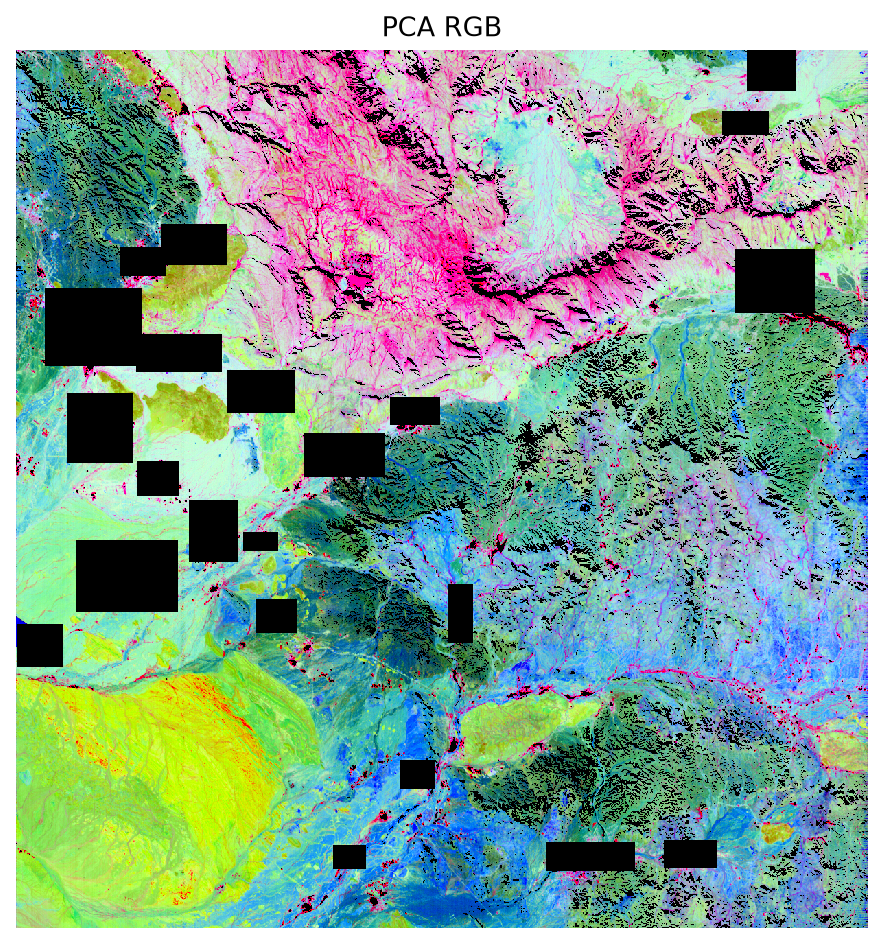
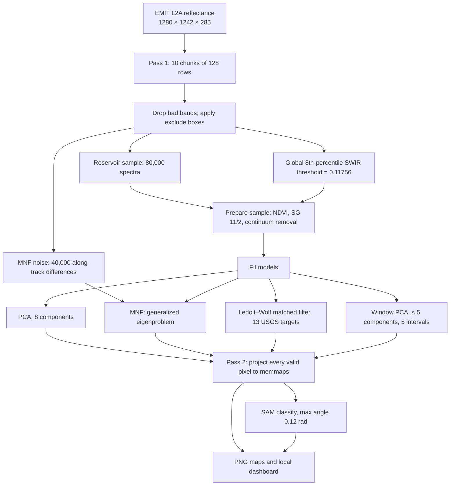
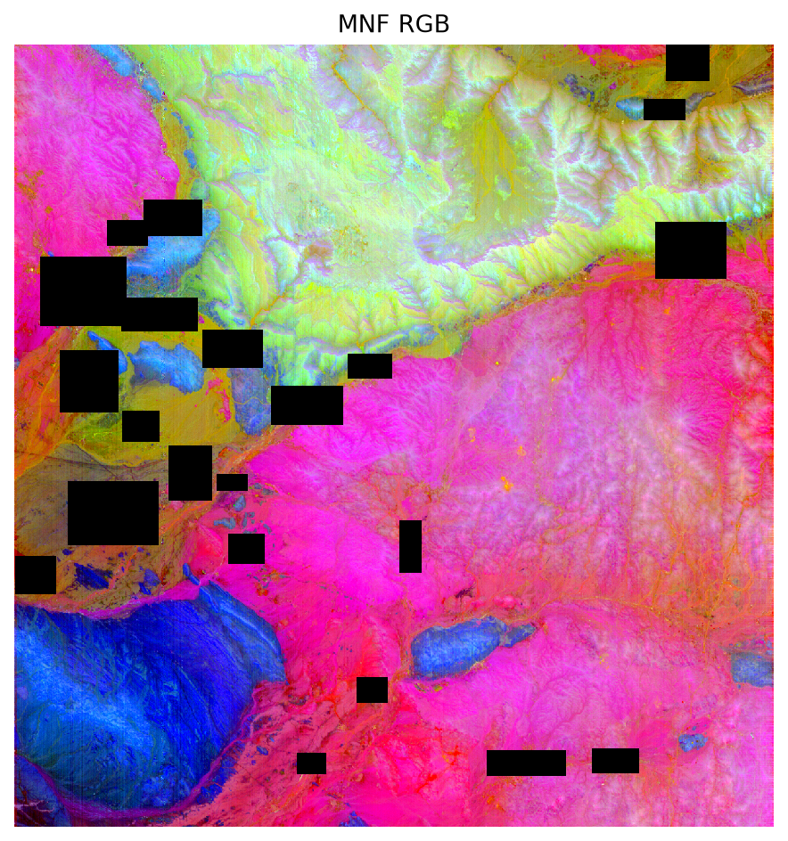
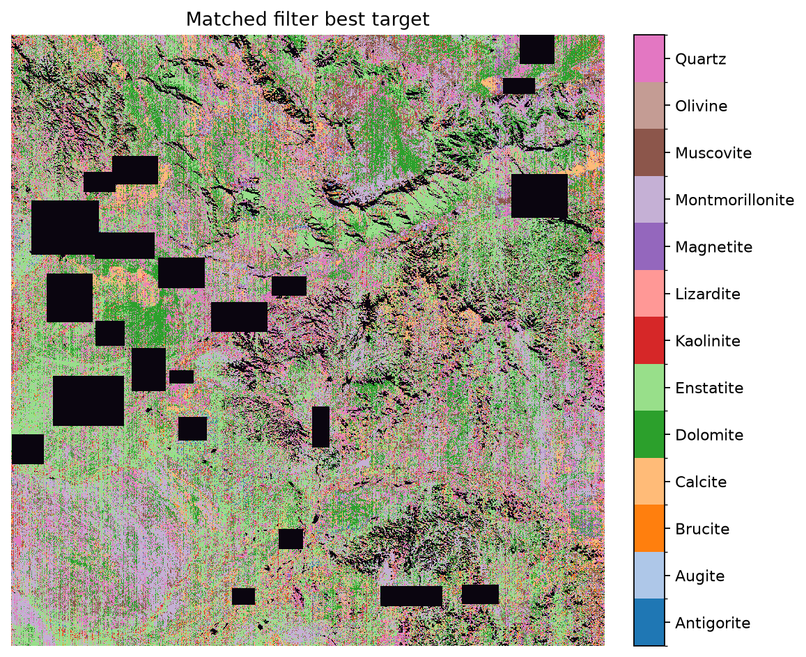
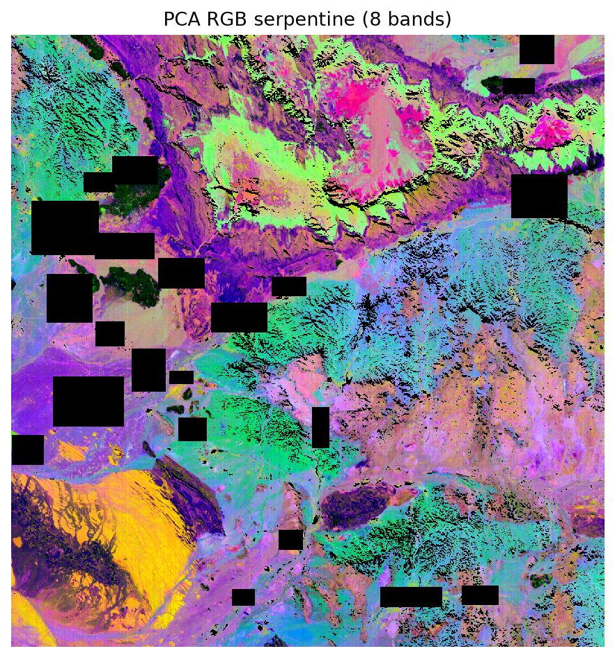

# Serpentine Signals

**Streaming Hyperspectral Mapping of Carbon-Storage Minerals in the Samail Ophiolite with NASA EMIT**

A memory-safe streaming pipeline that maps serpentine, carbonate and other carbon-storage minerals across Oman's Samail ophiolite, using PCA, MNF, matched-filter and SAM analysis of NASA EMIT hyperspectral imagery, with an interactive dashboard for exploring the results.

Live dashboard: https://kevinhaoaus.github.io/EMITOphiolite/



*Figure 1. PCA RGB composite of EMIT L2A granule `EMIT_L2A_RFL_001_20260220T072251_2605105_013`. PC1–PC3 explain 0.344, 0.179 and 0.109 of the variance (cumulative 0.632).*

## Why it matters

The Samail ophiolite in Oman contains a large volume of mantle peridotite that reacts with CO₂ to form solid carbonate minerals. The figures below are theoretical or modeled upper bounds from the cited papers, not observed present-day rates.

- **77 trillion tons of CO₂** is the theoretical storage capacity if all Mg cations in the peridotite were converted to carbonate (Kelemen & Matter 2008).
- Engineered in situ carbonation **could consume more than 1 billion tons of CO₂ per year in Oman alone** (Kelemen & Matter 2008).
- Natural uptake today is only **≈ 10⁴ to 10⁵ tons per year** (Kelemen & Matter 2008).
- Heating and raising the partial pressure of CO₂ can increase the carbonation rate by a factor of **>10⁶** (Kelemen & Matter 2008).
- At about 185 °C and more than ~70 bar P(CO₂), solid storage may cost **on the order of $10 per ton** (NASEM 2019, Figure 6.17, as cited by Kelemen et al. 2019).

Spaceborne mineral maps of serpentine, carbonate and related phases are a way to locate and characterize the rocks that would host that reaction.

## Data

The full-scene run uses NASA EMIT L2A reflectance granule `EMIT_L2A_RFL_001_20260220T072251_2605105_013`:

| Item | Value |
| --- | --- |
| Cube shape | 1280 × 1242 × 285 bands, float32 (~1.85 GB file) |
| Good bands retained | 225 (450–1320, 1460–1780, 1970–2450 nm) |
| Manual exclude boxes | 22 (half-open) |
| Finite pixels after masking | 1,465,069 |
| Prepared pixels | 1,342,469 |
| Pixels removed by exclude boxes | 124,691 |
| Global SWIR shadow threshold | 0.11756 (8th percentile over the scene) |
| Target library | 13 USGS splib07 spectra |

Preparation also removes pixels with NDVI > 0.25, then applies a Savitzky–Golay filter (window 11, polynomial order 2) and upper-hull continuum removal.

The companion L2A quality mask `EMIT_L2A_MASK_001_20260220T072240_2605105_012` was **not** applied. Its downtrack/crosstrack shape matches the cube, but the latitude/longitude footprint is offset by up to 0.5706° (a different scene). It would have flagged 119,667 pixels. The pipeline applies a quality mask only when shape matches **and** `location/lat`/`lon` agree within 0.001°; `--force-quality-mask` skips the lat/lon check.

An official EMIT L2B mineral product, `EMIT_L2B_MIN_001_20260326T084318_2608506_030` (a different date and scene; 1920 × 1242), is used only as a name-joined quicklook. Names come from `mineral_metadata/name`, joined on `mineral_metadata/index == id`.

Raw EMIT granules are not stored in this repository. Download them from [NASA Earthdata](https://earthdata.nasa.gov/) into `data\`.

## Pipeline

The reflectance cube is never loaded whole. Two streaming passes read 128-row chunks (10 chunks on the full 1280-row scene). Pass 1 reservoir-samples 80,000 spectra for the PCA, matched-filter background and window PCAs, plus 40,000 along-track difference pairs for the MNF noise covariance (from 1,462,041 available pairs). The SWIR shadow threshold is computed once over the whole scene so every chunk uses the same cutoff. Pass 2 prepares each chunk again and writes PCA, MNF, matched-filter, SAM and window-PCA scores into float32 `.npy` memmaps.



Diagnostic windows, with band counts from the full run, are hematite 550–950 nm (54 bands), chlorite 2180–2265 nm (12), carbonate 2280–2380 nm (13), alteration 2100–2380 nm (38) and serpentine 2280–2340 nm (8). Each window PCA uses at most five components.

### Key equations

**Minimum noise fraction** (Green et al. 1988), solved with `scipy.linalg.eigh(signal_cov, noise_cov)` and eigenvalues in descending (SNR-like) order:

$$
\Sigma_s \mathbf{w} = \lambda \Sigma_n \mathbf{w}
$$

**Ledoit–Wolf shrinkage** (Ledoit & Wolf 2004) for the matched-filter background covariance when the number of samples exceeds the number of bands; otherwise a sample covariance with a ridge of \(10^{-3}\) times the mean eigenvalue is used:

$$
\hat{\Sigma} = (1-\hat{\delta})S + \hat{\delta}\frac{\mathrm{tr}(S)}{p}I
$$

**Matched filter** score for a target spectrum \(\mathbf{t}\) against a pixel \(\mathbf{x}\), with background mean \(\mathbf{m}\):

$$
\mathrm{MF}(\mathbf{x}) = \frac{(\mathbf{t}-\mathbf{m})^{\top}\hat{\Sigma}^{-1}(\mathbf{x}-\mathbf{m})}{(\mathbf{t}-\mathbf{m})^{\top}\hat{\Sigma}^{-1}(\mathbf{t}-\mathbf{m})}
$$

**Spectral angle mapper**, in radians, with a 0.12 rad cutoff:

$$
\theta(\mathbf{x},\mathbf{t}) = \arccos\left(\frac{\mathbf{x}\cdot\mathbf{t}}{\lVert\mathbf{x}\rVert\,\lVert\mathbf{t}\rVert}\right)
$$

## Results

Numbers below are from the full-scene run of granule `..._013` (654 s, peak memory 2,297 MB on a 32 GB machine). A 256-row smoke test (`--rows 0:256`) finished in 201 s with a 1,959 MB peak. Preprocessing cost was 0.273 ms/pixel. Eighteen tests passed in 4.38 s.

| Product | Result |
| --- | --- |
| Runtime / peak memory | 654 s / 2,297 MB |
| Streaming layout | 2 passes, 10 chunks × 128 rows, float32 memmaps |
| Fit sample | 80,000 spectra; 40,000 MNF noise pairs |
| Prepared pixels | 1,342,469 of 1,465,069 finite pixels |
| Exclude-box removals | 124,691 |
| PCA variance, PC1–PC3 | 0.344, 0.179, 0.109 (cumulative 0.632) |
| MNF eigenvalues, components 1–3 | 53.3, 30.1, 16.8 |
| SAM median best angle | 0.025 rad |
| SAM 0.12 rad cutoff | rejected none of the 1,342,469 prepared pixels |
| Example pixel (640, 620) | Calcite at 0.032 rad |
| Matched-filter 99th percentile | Dolomite 0.142, Quartz 0.137, Enstatite 0.121 |
| Tests | 18 passed in 4.38 s |

On the L2B quicklook scene (different date and footprint; 2,384,640 pixels, 41 finite mineral ids), the most common classes after joining `mineral_metadata/index == id` were:

| id | Name | Pixels | Share |
| --- | --- | ---: | ---: |
| 0 | unclassified | 1,170,937 | 49.1% |
| 20 | Cummingtonite | 277,667 | — |
| 46 | nHematite+fg-Goethite | 259,416 | — |
| 52 | Renyolds_TnlSldgWet | 160,059 | — |
| 8 | Goethite thin film | 116,669 | — |
| 64 | Siderite | 95,269 | — |
| 45 | Nanohematite | 83,525 | — |

### Figure gallery

| PCA RGB | MNF RGB |
| --- | --- |
|  |  |
| **SAM labels** | **Matched-filter best labels** |
|  |  |
| **Serpentine-window PCA** (2280–2340 nm) | **EMIT L2B mineral map** (different scene) |
|  |  |

The run wrote 24 PNG maps under `outputs\` (not in git): the six figures above, plus `sam_angles.png`, 13 per-mineral `mf_*.png` maps, and the remaining four window-PCA RGBs.

## Repository layout

```
pipeline.py             Streaming mineral-mapping entry point
src/                    Cube I/O, masks, preprocessing, PCA, MNF, MF, SAM, plotting
scripts/mineral_quicklook.py   L2B name-joined mineral map
tests/                  18 tests (synthetic, pipeline, and streaming)
webapp/                 Local FastAPI dashboard (127.0.0.1:8000)
webapp/start.bat        Double-click launcher for the dashboard
usgs/                   USGS splib07 target spectra
assets/readme/          Downscaled figures used in this README
data/                   EMIT granules (gitignored; download from NASA Earthdata)
outputs/                PNG maps and .npy score memmaps (gitignored)
requirements.txt
```

## Quickstart

Use Python 3.11 (`py -3.11`); the default `python` may not have the science stack. From the project root:

```
py -3.11 -m pip install -r requirements.txt
py -3.11 -m pytest
```

Download the EMIT L2A reflectance granule (and, optionally, the L2B mineral product) from NASA Earthdata into `data\`. Then run the full scene:

```
py -3.11 pipeline.py --reflectance data\EMIT_L2A_RFL_001_20260220T072251_2605105_013.nc --usgs usgs --out outputs --mask-boxes data\manual_mask_boxes.json --components 8
```

Smoke test on the first 256 downtrack rows:

```
py -3.11 pipeline.py --reflectance data\EMIT_L2A_RFL_001_20260220T072251_2605105_013.nc --usgs usgs --out outputs\subset --mask-boxes data\manual_mask_boxes.json --components 8 --rows 0:256
```

Useful flags:

- `--reflectance`, `--usgs`, `--out` (required).
- `--mask-boxes` JSON of half-open `[row0, row1, col0, col1)` exclude boxes in full-granule coordinates (`data\manual_mask_boxes.json` is for granule `..._2605105_013` only).
- `--components` (default 8): PCA and MNF components. Diagnostic windows always use at most 5.
- `--max-fit-pixels` (default 80000): cap on sampled spectra for the PCA fit, the MNF signal covariance, and the matched-filter background.
- `--chunk-rows` (default 128): downtrack rows read per chunk.
- `--noise-fit-pixels` (default `max-fit-pixels / 2`): cap on sampled along-track difference spectra for the MNF noise covariance.
- `--rows START:STOP`: process only a downtrack row range (half-open).
- `--quality-mask PATH`: an EMIT L2A MASK granule. Only the cloud, cirrus, water, and spacecraft flag layers are used (never the per-band data mask). It is applied only if its downtrack/crosstrack shape matches the cube **and** its `location/lat`/`lon` agree within 0.001 deg; `--force-quality-mask` skips the lat/lon check. Note: `data\EMIT_L2A_MASK_001_20260220T072240_2605105_012.nc` has the same 1280 × 1242 shape as `..._013` but belongs to the previous scene (footprint offset about 0.57 deg), so the pipeline reports it and does not use it.
- `--seed` (default 0): random seed for the fit samples.

Outputs land in `--out`: `pca_rgb.png`, `pca_explained.txt`, `mnf_rgb.png`, `mnf_eigenvalues.txt`, `mf_{name}.png`, `mf_best_labels.png`, `sam_labels.png`, `sam_angles.png`, and `window_{name}_pca_rgb.png`. Score maps are kept on disk as `.npy` memmaps in `--out\maps\`: `pca_scores.npy` (H, W, k), `mnf_scores.npy` (H, W, k), `mf_{name}.npy` (H, W), `sam_labels.npy` (H, W, int16, -1 = unlabeled), `sam_angles.npy` (H, W, radians), and `window_{name}_pca.npy` (H, W, ≤5). Non-processed pixels are NaN.

L2B mineral quicklook:

```
py -3.11 scripts\mineral_quicklook.py
```

writes `outputs\emit_l2b_mineral_map.png` from `data\EMIT_L2B_MIN_001_20260326T084318_2608506_030.nc`.

To explore the products in the browser, start the local dashboard (binds to `127.0.0.1` only):

```
webapp\start.bat
```

or `py -3.11 -m webapp`, then open http://127.0.0.1:8000.

## Limitations

- There is no field validation of the SAM or matched-filter labels against samples from this scene.
- The 0.12 rad SAM cutoff rejected no prepared pixels; the median best angle was 0.025 rad, so every prepared pixel received a library label. Unlabeled pixels (`-1`) are only the 247,291 masked or unprepared locations.
- Matched-filter scores are relative detections, not mineral abundances or modal fractions.
- The `_012` L2A quality mask was rejected because of a 0.5706° lat/lon offset and was not used.
- Results are from a single EMIT granule; the L2B comparison is a different date and footprint.

## References

Green, A. A., M. Berman, P. Switzer, and M. D. Craig. 1988. A transformation for ordering multispectral data in terms of image quality with implications for noise removal. *IEEE Transactions on Geoscience and Remote Sensing* 26 (1): 65–74. https://doi.org/10.1109/36.3001

Kelemen, P. B., and J. Matter. 2008. In situ carbonation of peridotite for CO₂ storage. *Proceedings of the National Academy of Sciences* 105 (45): 17295–17300. https://doi.org/10.1073/pnas.0805794105

Kelemen, P., S. M. Benson, H. Pilorgé, P. Psarras, and J. Wilcox. 2019. An overview of the status and challenges of CO₂ storage in minerals and geological formations. *Frontiers in Climate* 1: 9. https://doi.org/10.3389/fclim.2019.00009

Ledoit, O., and M. Wolf. 2004. A well-conditioned estimator for large-dimensional covariance matrices. *Journal of Multivariate Analysis* 88 (2): 365–411. https://doi.org/10.1016/S0047-259X(03)00096-4

National Academies of Sciences, Engineering, and Medicine. 2019. *Negative Emissions Technologies and Reliable Sequestration: A Research Agenda*, Figure 6.17, as cited by Kelemen et al. (2019).

## Acknowledgements

NASA/JPL Earth Surface Mineral Dust Source Investigation (EMIT) for the L2A reflectance and L2B mineral products. U.S. Geological Survey Spectral Library Version 7 (splib07) for the target spectra.
